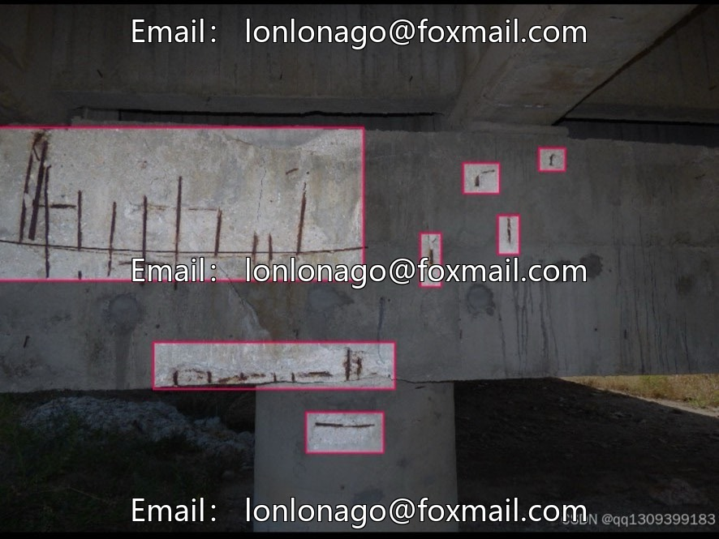
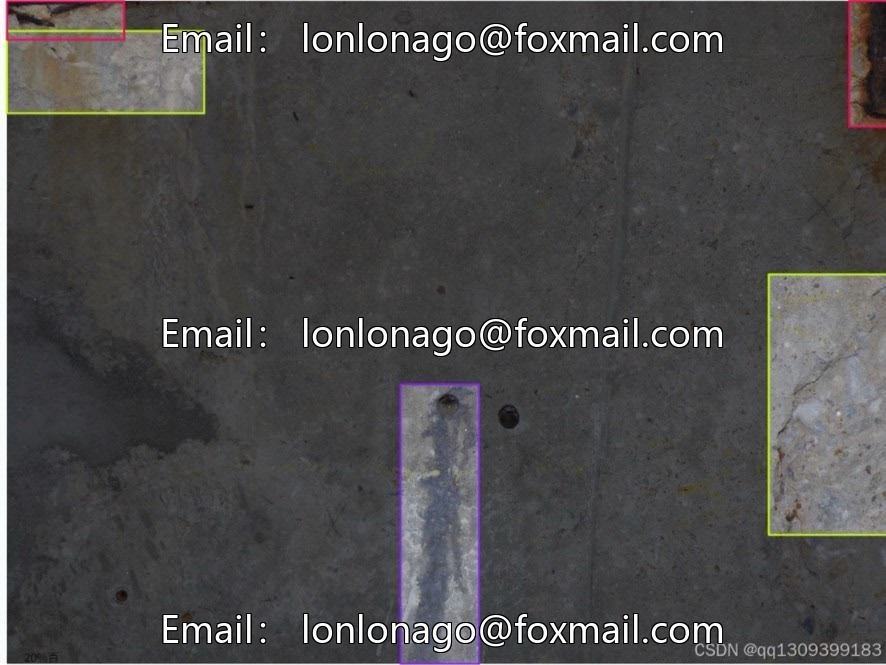
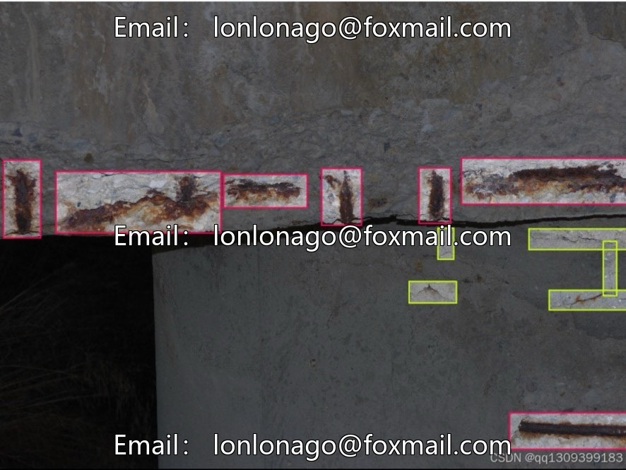
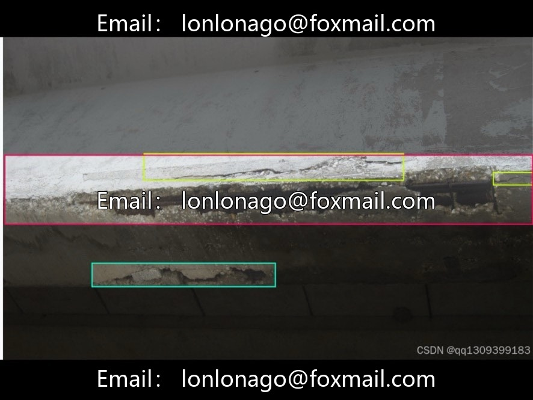
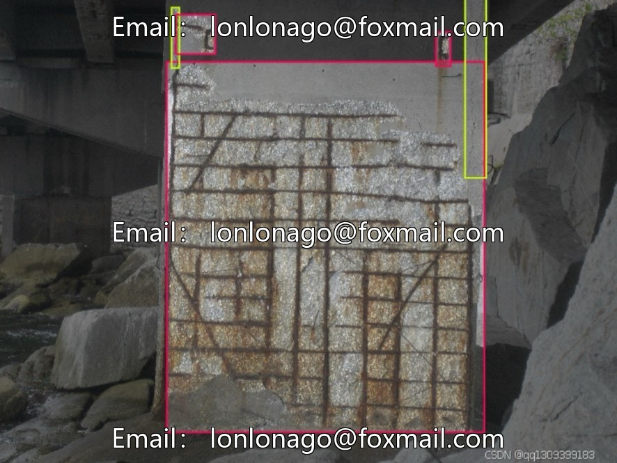
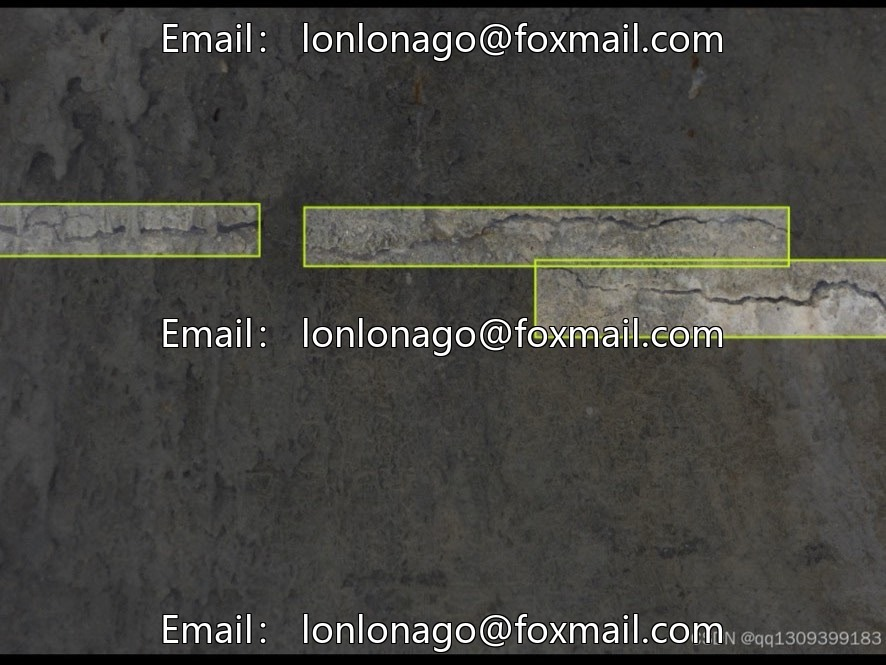

# Bridge Crack Damage Detection Dataset | Issue 100050

## Body

Bridge Crack Damage Detection Dataset | Issue 100050
A specialized visual dataset for drone bridge inspection and structural health monitoring, focusing on cracks and other types of bridge damage identification.

Base Scale: 889 bridge real-scene images, 5 sub-datasets, can be trained according to bridge types, disease degree, shooting scene, sample covers various bridge real scenes, suitable for basic model training and scientific research.

4 Category Annotation Objectives
1. Crack (General Crack)
2. Exposed Crack (External Crack)
3. Non-exposed Crack (Hidden Crack)
4. Other (Other Damages): Corrosion, Peeling, etc., to enhance the model's generalization capabilities

Dataset splitting rules: There is no official fixed ratio; industry-wide common practices are 7:1:2 or 8:1:1 for training, validation, and testing sets. The training set focuses on learning crack textures, the validation set fine-tunes hyperparameters to prevent overfitting, and the test set evaluates the model's generalization performance.

Image resolution: UAV and ground camera acquisition, the resolution is not unified, multi-scale samples adapt to long distance macro photography and close-up cracks in detail, while ensuring recognition accuracy and inference efficiency.

Core application scenarios
1. Bridge Normalized Automated Inspection: Drone aerial photography replaces manual climbs to identify concealed and exposed cracks, reducing inspection risks.
2. Post-disaster bridge safety assessment: Rapid screening of bridge damage and cracks after earthquakes and floods, assisting in the formulation of emergency repair plans.
3. Construction Quality Monitoring: Real-time detection of early cracks in the under-construction bridges, timely rectification to ensure construction standards.
4. Intelligent Bridge Maintenance System: Long-term tracking of disease development trends, predicting the remaining lifespan of bridges, and scientifically planning maintenance cycles.
5. Bridge Vision Algorithm Research: Basic Materials for Crack Detection, Segmentation Model Training, and Comparative Testing

Virtual materials, once sold, are non-refundable.
Interested friends, click "I want" to proceed.

## Images

## Payment

Here is a pay link on Stripe ( https://buy.stripe.com/3cs8yP7sY87d0vu9AB ). Please contact me lonlonago@foxmail.com after funding $89, and I will send you a complete data files , thank you!

